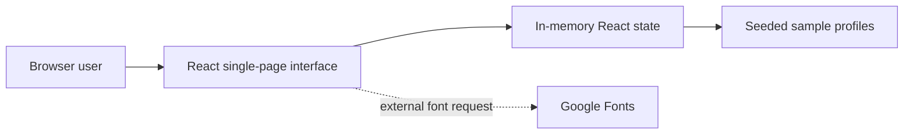

# SkillSwap

**Learn something. Teach something. Grow together.** SkillSwap is a responsive React prototype for exploring reciprocal skill exchanges: find sample community members who can teach skills you want to learn and who want to learn skills you can teach.

> This repository contains a frontend prototype. Profiles are seeded examples; there is no backend, authentication, messaging service, or persistent database. Edits and requests exist only in the current browser session.

## Why SkillSwap?

Finding a learning partner can be difficult, especially when learning communities are organized around one-way teaching. SkillSwap explores a simple reciprocal model where two people exchange knowledge without money.

## Features

- Home page describing the exchange flow.
- Explore seeded sample profiles with reciprocal skill match scores and text search.
- Add and remove skills you can teach or want to learn.
- View matching profile details and create an in-session exchange request.
- Review and cancel pending requests; view a basic profile summary.
- Responsive layout for desktop and smaller screens.

## Screenshots

No screenshots were provided with the source files. Add verified screenshots here when available.

## Technology


- React for the interactive interface.
- Vite for local development and static production builds.
- Plain CSS for styling and responsive layouts.
- Google Fonts (DM Sans and Plus Jakarta Sans) are requested by the stylesheet when network access is available; system sans-serif fallbacks are provided.

## Architecture



There is no API or server-side component. A refresh resets edits and requests. The app can be hosted as a static site.

## Project structure

```text
.
├── index.html          # Vite HTML entry point and page metadata
├── src/
│   ├── App.jsx         # Screens, sample data, matching and interactions
│   ├── main.jsx        # React bootstrap
│   └── style.css       # Responsive visual styles
├── package.json
└── .gitignore
```

## Requirements

- Node.js 20.19+ or 22.12+ (Vite requirement)
- npm

## Run locally

```sh
npm install
npm run dev
```

Open the local URL printed by Vite. To create and preview the production build:

```sh
npm run build
npm run preview
```

## Environment configuration

No environment variables are used. There is no `.env.example` because the current app has no runtime configuration.

## Using the app

Use the navigation to explore the sample profiles, edit teaching and learning skills, inspect profile matches, send an exchange request, and review or cancel pending requests. Match data and requests are demo state held in memory; do not use the seeded profiles as real people or contact information.

## API

There is no API in this frontend prototype.

## Deployment

The production build is static and is written to `dist/`. GitHub Pages serves the built static files from the `gh-pages` branch. The Vite base path is configured for the `skillswap` repository. After the first build is deployed, configure the repository Pages source to `gh-pages` / root in **Settings → Pages**. Future releases require rebuilding and pushing the new `dist/` contents to that branch. The public URL is `https://neeharikaannaluru25.github.io/skillswap/`; it is not live until Pages is enabled and GitHub finishes publishing. The build settings are:

- Build command: `npm run build`
- Output directory: `dist`
- Environment variables: none

No SPA fallback is required because the app uses in-memory page navigation rather than URL routes.

## Security and privacy

The app does not collect or transmit user data. It has no authentication, database, or secret keys. Do not add real personal data to the sample profiles. Any future backend should add server-side authorization, input validation, privacy controls, and secure secret handling before public use.

## Roadmap

- Persist user profiles and requests through a documented backend.
- Add account management, privacy controls, and real partner communication.
- Improve keyboard access and automated accessibility coverage.
- Replace sample profiles with verified participants and connect the directory to a real service.

## Author

Created by [neeharikaannaluru25](https://github.com/neeharikaannaluru25).

## Repository and live site

- GitHub profile: https://github.com/neeharikaannaluru25
- Repository: https://github.com/neeharikaannaluru25/skillswap.
- Expected Pages URL: https://neeharikaannaluru25.github.io/skillswap/ (not yet deployed).
